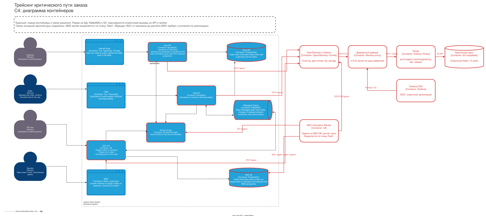
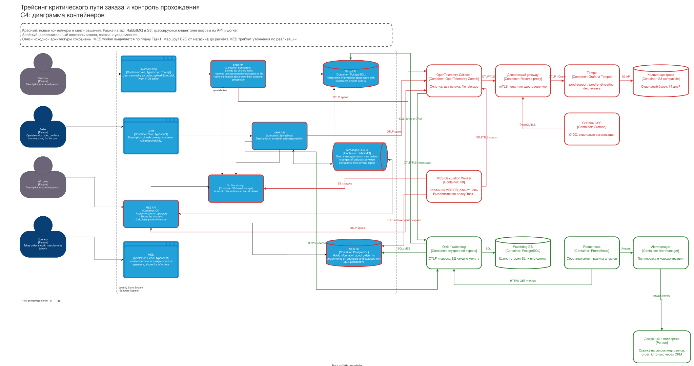

# Архитектурное решение по трейсингу

## Где может остановиться заказ

На исходной C4-схеме заказ проходит через Internet Shop и Shop API, Shop DB и хранилище 3D-файлов, затем через расчёт MES API, MES DB, RabbitMQ и CRM API. Партнёр входит прямо в MES API. Изменения статусов идут также от MES UI и CRM UI. На схеме не обозначен вызов, который запускает расчёт MES после заказа в магазине; это пробел в описании, а не основание придумывать синхронную связь. Его нужно найти в реализации и добавить к инструментированию.

Покрыть следует точки приёма B2C/B2B, загрузку и чтение модели, вызов и ожидание расчёта цены, запись заказа, публикацию события, получение и обработку сообщения, обновление CRM и MES DB, подтверждение события, назначение оператору и каждый последующий переход до CLOSED. Для внешней транспортной компании, которой нет на схеме, фиксируется лишь входящий callback или ручное закрытие CRM после уточнения фактического интерфейса. Возможные поломки: запрос принят без записи, файл не найден, расчёт долго ждёт или падает, БД обновлена без события, событие отправлено без подтверждения, маршрут RabbitMQ не привёл к потребителю, обработка повторилась или закончилась ошибкой, CRM не создала заказ, статус перезаписан более старым событием.

## Мотивация

Поддержке нужен ответ по конкретному заказу: какой шаг завершился, сколько он длился и какой шаг ожидается. Разработчикам нужна та же цепочка через HTTP, БД и RabbitMQ, чтобы локализовать задержку. Трейсинг уменьшит время поиска причины, но не заменит долговременный реестр состояний: завершённая трасса не доказывает, что заказ когда-либо дошёл до следующего шага.

Показатели эффекта: медианное время локализации причины инцидента, доля заказов с полной корреляцией от приёма до CRM, p95 времени расчёта цены, доля переходов с превышенным сроком и число обращений, для которых поддержке понадобился повторный запрос к клиенту. Эти показатели измеряются до внедрения и после него; снижение просрочек от одной установки инструмента не обещается.

## Данные трейса

Каждый span содержит `trace_id`, `span_id`, parent или links, время начала, длительность, `service.name`, `deployment.environment.name`, имя операции, результат и безопасный код ошибки. Для HTTP сохраняются шаблон маршрута, метод и класс ответа; для SQL только логическое имя операции и имя БД, без запроса с параметрами; для RabbitMQ имя exchange/queue, тип события, `event_id`, число попыток и факт ack/nack. Бизнес-span перехода включает `order_id`, `event_id`, канал B2C/B2B, предыдущий и новый статус, `source`, `source_version`, `causation_id`, время события и длительность ожидания. `event_id` связывает span с записью журнала владельца. Смысл версий задан в Task1: версии разных источников не сравниваются. Для расчёта допустим диапазон числа полигонов, а не файл или его содержимое. `partner_id` допускается в техническом потоке; ключ API, ФИО, адрес, телефон, платёжные данные и ссылку на S3 не пишем.

`trace_id` связывает операции одной цепочки обработки через несколько сервисов; `order_id` связывает отдельные трейсы в течение недель. `event_id` нужен для повторной доставки. При входе из партнёрского API внешний `traceparent` не считается доверенным: шлюз проверяет формат и начинает внутреннюю цепочку, сохраняя безопасный внешний correlation ID отдельно. Все часы синхронизированы, иначе длительность между системами вводит в заблуждение.

## Предлагаемое решение

В Spring Boot и C# внедрить OpenTelemetry SDK и инструментирование HTTP, PostgreSQL и RabbitMQ. Сначала добавить ручные business spans на создание заказа, расчёт цены, публикацию, обработку и смену статуса; инструментирование браузеров отложить до согласования защиты клиентских данных. Производитель вставляет W3C trace context в заголовки AMQP. Потребитель извлекает его, создаёт span обработки с link на контекст сообщения, записывает результат и подтверждает сообщение только после фиксации бизнес-операции. Для событий, отправленных из outbox фоновым процессом, link соединяет новую трассу с исходной; доступный `order_id` остаётся главным способом собрать многодневную историю.

На схеме также показан отдельный MES Calculation Worker из целевой архитектуры Task1. Он читает долговечные задачи из MES DB, получает модель из S3 и пишет результат в MES DB. Worker инструментируется тем же C# SDK и отправляет OTLP в Collector. До выделения worker эти spans создаёт текущий расчёт в MES API; после переноса в API остаётся span постановки задачи. Контекст исходного запроса сохраняется вместе с задачей, поэтому перезапуск и задержка запуска не разрывают связь расчёта с заказом. Старые связи API с БД и S3 нужны также для других операций и сохранены.

Приложения посылают OTLP по TLS с сервисной аутентификацией в приватный OpenTelemetry Collector. Он удаляет запрещённые атрибуты, ограничивает размер и передаёт spans через доверенный gateway в Grafana Tempo на отдельном S3-бакете. Collector формирует два потока prod: технический без персональных данных для инженеров и сокращённый поток бизнес-переходов для поддержки. Во втором остаются только корреляционные ID, статус, время, результат и безопасный код ошибки, без SQL, сетевых адресов и текста исключения. Оба потока направляются в разные tenants Tempo; dev и release тоже имеют отдельные tenants. Стартовый срок хранения 14 дней. Пропуск span и сбой Collector не блокируют заказ. Полная история переходов хранится 180 дней в транзакционном журнале владельца, с последующим пересмотром срока по требованиям договоров.

В SDK на первом этапе записываются все spans критического пути. Поток переходов в Watchdog ответвляется до семплирования технических чтений. Расчёт цены до 30 минут и бизнес-переходы обходят tail sampler. После замера объёма семплирование включается только для заранее определённых маршрутов короткого чтения; все spans одного трейса направляются в один sampler по `trace_id`, head sampling их не отбрасывает.

Начальные настройки: `decision_wait=60s`, режим `trace-complete`, без ускоренного решения после получения root span. Процессор оценивает накопленные spans по таймеру от первого полученного span; достоверного сигнала завершения всего трейсбека у него нет. Политики сохраняют их с уже полученным ERROR или длительностью более 2 секунд, а остальные выбирают с вероятностью 10%. Поздняя ошибка может не повлиять на принятое решение.

Для этих маршрутов предлагается предел выполнения 30 секунд и доставка завершённого span до sampler за 10 секунд, включая batching SDK до 5 секунд. Окно 60 секунд оставляет запас 20 секунд; параметры подтверждаются в release до включения. `num_traces` рассчитывается минимум на двойной пиковый поток за окно ожидания. Включаются оба decision cache с ёмкостью на десятиминутный пиковый поток. Пока решение сохранено, поздние spans наследуют его, включая отбрасывание. После вытеснения решения возможна отдельная оценка фрагмента трейсбека. Кеш не восстанавливает ранее отброшенные spans.

Полное сохранение ошибок при потере телеметрии, поздней доставке или переполнении sampler не гарантируется. Контролируются задержка экспорта, `sampling_late_span_age` и `sampling_trace_dropped_too_early`; при нарушении бюджета задержки дежурный проверяет буферы и при наличии ёмкости временно отключает семплирование чтений. ERROR-логи и журнал переходов сохраняют отдельный путь диагностики. Приёмка включает задержанный более чем на 60 секунд ERROR-span, вытеснение decision cache и переполнение буфера. Проверяется фактическая потеря детализации трейса, а не обещание восстановить его задним числом.

Collector Contrib использует ограниченную очередь экспорта с расширением `file_storage`; каждый exporter имеет собственную очередь и предел повторов. Недоступность Watchdog не останавливает экспорт в Tempo. Буфер экспорта переживает обычный перезапуск, но незавершённое решение tail sampler находится в памяти и может потеряться. Контролируются ошибки экспорта, размер очереди, свободный диск и отброшенные spans. На старте допустим один Collector с контролем доступности, затем два при подтверждённой нагрузке. Дисковый буфер повышает устойчивость телеметрии, но не заменяет журнал заказа.

На [диаграмме контейнеров с трассировкой](../diagrams/alexandrite-tracing.drawio) красным выделены MES worker, Collector, gateway, Tempo, Grafana, хранилище трасс и новые связи. Красные рамки на API отмечают инструментирование. Рамки на RabbitMQ, БД и S3 показывают покрытие клиентских вызовов из API и worker; SDK внутрь PostgreSQL или брокера не устанавливается. Связи исходной схемы сохранены; направление каждого типа сообщения уточняется по коду.

### Автоматический контроль прохождения заказа

Collector дополнительно отправляет обезличенные spans переходов по OTLP в приёмник Order Watchdog. Это небольшой внутренний сервис, который нужно реализовать; готовый Tempo сам не ведёт реестр незавершённых заказов. Приёмник валидирует схему, записывает span в Watchdog DB и только затем отвечает успехом. Watchdog использует spans для измерения длительности шагов и диагностики, но отсутствие span не считает доказательством отсутствия заказа. Каждую минуту он сверяет принятые `order_id` и текущие состояния с авторитетными таблицами Shop DB, MES DB и журналом переходов. Для B2B исходная запись приёма находится в MES DB. Чтение идёт по TLS отдельной учётной записью только для чтения согласованных представлений, по индексам `order_id`, `accepted_at`, `status_entered_at`; нагрузка и время сверки контролируются метриками.

Watchdog хранит состояние в отдельной PostgreSQL DB: `order_progress` с текущим шагом, временем входа, владельцем, версиями каждого источника и временем последней успешной сверки; `step_history` с подтверждёнными началом, deadline и завершением шага для SLI из Task2; `seen_span` с уникальностью `(trace_id, span_id)` на 14 дней; `seen_event` с уникальным `event_id` на 180 дней; `incident` с уникальностью `(order_id, expected_step, triggering_event_id, threshold_class)` и состоянием разбора. `step_history` и история инцидентов хранятся 180 дней. Событие от MES не сравнивается по версии с событием CRM. Span служит подсказкой для проверки, а подтверждённое состояние обновляется только по журналу владельца. Повторный span не создаёт новый инцидент. Поздний span не откатывает уже подтверждённый шаг.

Сверка читает индексированные представления приёма и журналов переходов небольшими страницами. Каждую минуту она заново получает все принятые незавершённые заказы из источников, включая ещё неизвестные Watchdog. Поэтому потеря span или записи в быстром потоке не скрывает открытый заказ. Для истории используется курсор `(recorded_at, event_id)` с перекрытием окна и дедупликацией. `recorded_at` задаётся при записи, но не является порядком коммитов: долгий коммит может оказаться позади курсора. Перекрытие выбирается больше установленного предела длительности транзакции; нарушение предела вызывает технический алерт. Ночью полностью сверяются реестр приёма и журналы за срок хранения, включая закрытые заказы, чтобы восстановить пропущенные переходы и исторические нарушения. После перезапуска Watchdog восстанавливает сохранённое состояние и догоняет записи. Если одна из БД недоступна, состояние помечается как неизвестное, открытые инциденты не закрываются; отдельная метрика показывает давность успешной сверки. Прямое чтение ограничено согласованными представлениями и является временным контрактом диагностики, а не зависимостью приложения от чужих таблиц.

Watchdog записывает инцидент, а Prometheus формирует агрегированный алерт после двух подтверждённых циклов. В сообщении есть канал, ожидаемый шаг и ссылка на рабочий список, без номеров заказов. Номера доступны поддержке через защищённый интерфейс CRM. После подтверждённого следующего шага инцидент закрывается. Alertmanager группирует уведомления по каналу и шагу; повторная сверка не создаёт отдельный звонок на каждый заказ.

Закрытие означает устранение текущей проблемы, а запись нарушения и реальные времена остаются в истории. Историческая сверка исправляет SLI, но не вызывает звонок по уже закрытому заказу. Она создаёт задачу разбора, если восстановление выявило ранее неизвестную потерю или системную ошибку. Данные двух БД могут быть прочитаны в разные моменты: до алерта повторно проверяется журнал ожидаемого владельца, а недостающий источник отмечается как неизвестный. Технические пороги используют UTC; рабочие сроки продаж и производства вычисляются по утверждённому календарю подразделения.

| Ожидаемый шаг | Старт и первоначальный порог | Владелец реакции |
|---|---|---|
| B2C SUBMITTED или приём B2B → PRICE_CALCULATED | `accepted_at`, 35 минут с учётом верхней границы расчёта 30 минут и пяти минут запаса | Дежурный MES проверяет worker, модель и очередь |
| B2B PRICE_CALCULATED → запись заказа в CRM | Время расчёта, 5 минут; маршрут B2C определяется картой из Task1 | Дежурные CRM и интеграции проверяют outbox, RabbitMQ и DLQ |
| Заказ с рассчитанной ценой в CRM → MANUFACTURING_APPROVED | Начальный порог 4 часа рабочего времени после появления цены и CRM-записи; согласовать с продажами | Руководитель продаж проверяет ожидание клиента и действия продавца |
| MANUFACTURING_APPROVED в CRM → подтверждение применения в MES | Время коммита CRM, 5 минут | Дежурный проверяет событие подтверждения и inbox MES |
| MANUFACTURING_APPROVED → MANUFACTURING_STARTED | Время применения подтверждения в MES, начальный порог 4 часа рабочего времени | Начальник смены обрабатывает срочную очередь по правилу Task1; при отсутствии назначения за 30 рабочих минут эскалирует руководителю производства |
| Производственные статусы до SHIPPED | Сравнение `status_entered_at` с утверждённым планом этапа и `promised_at` | Руководитель производства; пороги этапов утверждаются до включения оповещений |
| SHIPPED → CLOSED | Срок подтверждения от перевозчика по договору; ручное закрытие требует основания | Поддержка и логистика |

Пороги расчёта и межсистемной доставки технические; подтверждение продавцом, назначение и производство согласуются с бизнесом по рабочему календарю. INITIATED и FILE_UPLOADED ещё не принятые заказы: незавершённая корзина не создаёт производственный инцидент. Для ожидания операторов отсчёт начинается с подтверждённого применения MANUFACTURING_APPROVED в MES. Независимая проверка отсутствия CRM-записи через 40 минут от приёма совпадает с Task2. Prometheus опрашивает `/metrics` Watchdog и получает агрегаты по каналу, шагу и порогу. Для конкретных заказов CRM API вызывает внутренний read-only endpoint Watchdog после проверки роли поддержки; доступ аудируется. На [дополненной диаграмме](../diagrams/alexandrite-tracing-watchdog.drawio) зелёным показаны Watchdog, его DB, запрос Prometheus, доступ CRM к рабочему списку и путь уведомлений.

Проверка решения включает остановку потребителя, потерю span, повторную доставку, событие не по порядку, недоступную БД и перезапуск Watchdog. В каждом случае поддержка должна видеть подтверждённый шаг или явное отсутствие свежих данных. Потеря span не скрывает принятый заказ, а повтор не создаёт второй инцидент.

## Компромиссы

Автоматические HTTP- и DB-spans сами по себе не объяснят, почему заказ не был опубликован. Нужны ручные бизнес-spans и надёжная запись событий. Трасса не существует для операции, которая не началась, и может быть неполной при сбое процесса, потере телеметрии, старом сообщении без заголовков или после истечения срока хранения. Расчёт цены до 30 минут и производство в течение недель плохо представлять одной непрерывной трассой: используем связанные короткие трейсы и поиск по `order_id`. Полное хранение всех spans при росте нагрузки потребует затрат, поэтому сначала меряем объём. Если MES-код нельзя менять в каком-то участке, там доступны только spans на границе вызова и сообщения, а детализация внутри отсутствует.

## Безопасность

Выбрана Grafana OSS с отдельными организациями `prod-support`, `prod-engineering`, `dev-engineering` и `release-engineering`. Вход сотрудников выполняется через корпоративный OIDC с Generic OAuth. Настройки `org_attribute_path` и `org_mapping` сопоставляют заранее утверждённые группы только с нужными организациями и ролью Viewer; нет правила со звёздочкой, выдающего доступ всем. `role_attribute_strict=true` запрещает вход без соответствия, `skip_org_role_sync=false` обновляет членство при входе. Организация по умолчанию не содержит источников данных. Самостоятельная регистрация и обычный парольный вход выключены после настройки аварийной административной учётной записи. При увольнении группа отзывается в IdP, активные сессии завершаются по процедуре доступа. В каждой организации настроен ровно тот Tempo datasource, чей tenant разрешён этой группе. Поддержка может выполнять произвольные запросы только к сокращённому `prod-support`, инженеры к очищенному техническому `prod-engineering`. Отдельного ограничения по сервисам внутри инженерной группы нет. Создание источников данных и назначение администраторов доступны лишь DevOps с отдельной учётной записью. Роль Viewer и права папки не ограничивают запрос к доступному источнику, поэтому изоляция строится на организациях и tenants, а не на скрытых панелях.

Tempo включён в режиме multitenancy. Ни Grafana, ни приложения не имеют прямого сетевого доступа к Tempo: только gateway через приватный адрес и firewall. Gateway проверяет отдельные сервисные удостоверения для записи Collector и чтения datasource, удаляет присланный `X-Scope-OrgID` и назначает tenant по удостоверению и разрешённому маршруту. Для поддержки это всегда `prod-support`; нельзя запросить второй tenant подменой заголовка или параметра. Входные запросы, решения gateway и администраторские действия аудируются; тест доступа включает попытку прочитать чужой tenant. Межсервисный OTLP защищён TLS, для gateway используются mTLS или короткоживущие сервисные токены. Секреты хранятся вне кода; права на бакет трасс ограничены Tempo. В Collector удаляются токены, тела запросов, URL с параметрами и имена файлов, а в SDK действует allowlist атрибутов. Детали покупателя доступны через CRM по штатным правам, но не через Grafana.
