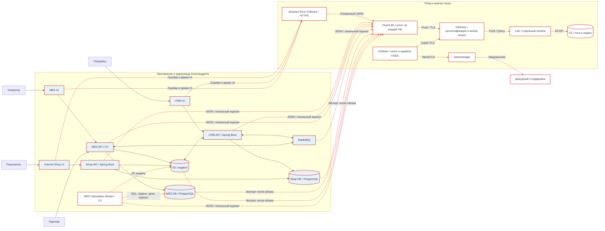

# Архитектурное решение по логированию

## Область и состав событий

Логи нужны в Shop API, CRM API, MES API и обработчиках RabbitMQ. После выделения расчёта из MES API источником становится также MES Calculation Worker; на схеме показано его целевое подключение, агент ставится на VM worker. Из RabbitMQ собираются события брокера о соединениях, маршрутизации и ошибках; из PostgreSQL двух БД берутся ошибки, долгие запросы и блокировки без параметров SQL; из S3-хранилища моделей берутся записи доступа и ошибок. Фронтенды Internet Shop, CRM и MES отправляют только обезличенные ошибки интерфейса и результат загрузки страницы с длительностью в отдельный Browser Error Collector по HTTPS. Он принимает запрос с действующей сессией приложения, проверяет схему и origin, ограничивает частоту по приложению и сессии, затем пишет очищенный JSON для Fluent Bit. Полям клиента доверять нельзя, поэтому Collector принимает только allowlist и не использует присланный уровень доступа. В браузере не сохраняем содержимое формы и 3D-модели. Источники и маршруты сбора показаны на схеме в разделе Предлагаемое решение.

Каждая запись имеет UTC-время, `service`, `env`, `level`, стабильный `event_name`, результат, код ошибки, `trace_id`, `span_id`, `order_id` и `event_id`, если они известны. Для запросов сохраняются шаблон маршрута, метод, класс ответа и длительность; для сообщения имя очереди, тип, попытка и результат ack/nack; для изменения статуса прежнее и новое значения, `source`, `source_version`, канал и роль инициатора. Версии имеют смысл только внутри источника, как определено в Task1. Идентификатор покупателя поддержка получает по `order_id` через CRM с проверкой прав. Если нужно связать действия пользователя, используется внутренний псевдоним с контролируемым доступом.

### События уровня INFO

| Событие | Поля сверх общих |
|---|---|
| Заказ принят магазином или партнёрским API | `order_id`, `channel`, `request_id`, `idempotency_result` |
| Файл модели сохранён или найден | `order_id`, `object_id` как внутренний идентификатор, `size_bucket`, `result` |
| Расчёт цены поставлен в очередь, начат и завершён | `order_id`, `job_id`, `duration_ms`, `complexity_bucket`, `result` |
| Событие опубликовано и подтверждено брокером | `event_id`, `order_id`, `event_type`, `destination`, `result` |
| Сообщение получено и успешно обработано | `event_id`, `order_id`, `attempt`, `consumer`, `outcome` |
| Заказ создан в CRM или статус изменён | `order_id`, `from_status`, `to_status`, `source`, `source_version`, `channel`, `actor_role` |
| Оператор взял заказ | `order_id`, `actor_role`, `result`, `version`; конкретный сотрудник доступен через CRM/MES-аудит |
| Заказ закрыт после уведомления перевозчика или вручную | `order_id`, `closure_source`, `result` |
| Служебный heartbeat доставки логов, раз в минуту | `event_name=pipeline_heartbeat`, имя источника и время формирования; только технический поток |

`WARN` используется для восстановимого сбоя, повтора, конфликтной версии и близкого к сроку заказа. `ERROR` означает завершившийся неудачей шаг, переход в DLQ или недоступную зависимость. `DEBUG` включают на короткое время по конкретному сервису и маршруту при расследовании, без тел запросов и секретов, с автоматическим отключением. Не пишем каждое чтение дашборда на INFO: оно даст много шума; используем агрегированные метрики и журнал ошибок. Стек-трейс фиксируется один раз на границе неудачной операции, с лимитом размера.

INFO подтверждает успешно зафиксированный факт. Для неуспешного расчёта используется ERROR, для повтора WARN; отдельная INFO-запись с той же ошибкой не создаётся. Событие смены статуса формируется после коммита, но при аварии процесса лог может не успеть записаться. Поэтому журнал переходов в БД остаётся доказательством изменения. Структурированная запись экранирует переносы строк и ограничивает длину входных полей, чтобы клиент не мог подделать соседнюю запись лога.

## Мотивация

Сейчас клиент фактически служит единственным источником информации об ошибке. Структурированные события позволят найти причину по номеру заказа, проверить, было ли подтверждено сообщение, и передать обращение ответственному за нужную систему. Журнал сохраняет принятые решения и результаты обработки, в том числе поздние повторы. Вместе с трассами он сокращает время расследования и помогает восстановить заказ.

Измеряем эффект по четырём показателям: время от обращения до найденного технического события, доля обращений с установленной причиной без повторного опроса клиента, число необработанных сообщений в DLQ, доля принятых заказов с записью создания в CRM. Само логирование не устраняет эти проблемы; его результатом считается более быстрое обнаружение и исправление.

Сначала настраиваем логи и трассы MES API, его расчёта, обработчиков RabbitMQ и CRM API, включая запись в MES DB и Shop DB. Здесь проходит новый B2B-поток и создаётся CRM-заказ; потеря на этой границе напрямую связана с жалобами партнёров. Параллельно добавляем событие приёма и корневой span в Shop API для B2C. На первом этапе у каждого принятого заказа уже есть `order_id`, а у публикации и обработки один `event_id`. Затем добавляем подробные серверные логи БД, брокера и S3, после этого фронтенды и остальные операции. Трассировку запросов к БД делают SDK в приложении, собственные spans от управляемой PostgreSQL не требуются. Такой порядок даёт сквозную корреляцию критического пути раньше, чем полный охват каждого экрана.

## Предлагаемое решение

Красным выделены источники логов, новые компоненты и связи сбора. Fluent Bit показан одним блоком для краткости, но устанавливается на каждой VM источника. Для управляемых БД и S3 используется доступный механизм экспорта облачных логов.

Приложения на VM пишут JSON в ротируемый файл. Для Java используется структурированный Logback, для C# Serilog; общая схема полей проверяется контрактным тестом. Агент Fluent Bit читает локальные JSON-логи через Tail, сохраняет позиции и удаляет запрещённые поля фильтром по allowlist. Если приложение сейчас пишет только в stdout, перед включением Tail настраивается сохранение этого потока в файл с ротацией либо отдельный вход системного журнала. Неподключённый stdout не считается собранным логом. Для очищенной копии поддержки создаются отдельные tag и output; произвольный tenant из записи клиента не используется. Логи брокера, PostgreSQL и S3 поступают через соответствующие экспортные механизмы облака или агент, если сервис предоставляет их; конкретный способ проверяется на используемом Managed Service. Для каждого приложения Fluent Bit отправляет очищенный технический поток в tenant `prod-engineering`, а разрешённые бизнес-события в ещё более сокращённом виде дублирует в tenant `prod-support`. Dev и release имеют отдельные tenants. Все записи и запросы идут через аутентифицирующий gateway, который назначает tenant; прямого доступа к Loki нет. Loki хранит chunks и индекс в отдельном S3-совместимом бакете, не в бакете 3D-моделей. Grafana даёт поиск и переход от `trace_id` к Tempo. Grafana Alerting раз в минуту вычисляет правила LogQL в инженерной организации и направляет события в внешний Alertmanager из Task2. Loki, Tempo и Prometheus получают отдельные хранилища и квоты, чтобы всплеск логов не вытеснил метрики.

В Loki индексируются только `env`, `service`, `source` и при необходимости `channel`. `order_id`, `trace_id`, `event_id` и пользовательские идентификаторы остаются полями JSON или структурированными метаданными, а не labels. Иначе поток создаст слишком много рядов.

### Безопасность и хранение

Тела HTTP-запросов, токены, адреса, телефоны, платёжные данные, содержимое модели и полные S3-ключи запрещены. Маскирование выполняется в приложении и повторно в Fluent Bit; тесты с контрольными секретами проверяют отсутствие утечки. Локальные файлы, Tail DB и дисковый буфер доступны только служебной учётной записи; диск зашифрован. `env`, `service` и `source` назначаются конфигурацией агента, а не данными клиента. Поток поддержки собирается по явному списку INFO-событий: приём заказа, смена статуса, результат расчёта, отправка и закрытие. Поля ограничены `event_name`, `order_id`, `event_id`, `trace_id`, `span_id`, временем, каналом, статусом и безопасным кодом результата. `event_name` позволяет отличить приём заказа от расчёта цены или смены статуса. Корреляционные ID добавляются, когда они известны, и остаются полями JSON. Ссылка по `trace_id` открывает только Tempo datasource tenant `prod-support`; права не расширяются. Если трасса потеряна или уже удалена, поддержка продолжает поиск по `order_id` в журнале CRM. Технические stack traces, SQL и внутренние адреса туда не копируются. Технический поток также не содержит персональных данных, но сохраняет диагностику для инженеров.

Используется та же Grafana OSS и те же четыре организации, что описаны в Task3. В `prod-support` находится только datasource tenant `prod-support`, в `prod-engineering` только технический tenant. У обычных пользователей роль Viewer; администрирование организаций и datasources доступно выделенной учётной записи DevOps. Инженеры этой группы видят технические логи всех трёх сервисов, ограничения по отдельным сервисам сейчас нет. Пользователь может выполнить произвольный LogQL-запрос к доступному datasource, поэтому папки и панели не используются как граница безопасности. При более узком разграничении потребуется отдельный tenant и организация на группу сервисов либо Grafana Enterprise/Cloud с правами на datasource.

Loki работает с `auth_enabled: true`. Доверенный gateway принимает TLS-соединения с отдельным удостоверением для каждого выходного потока Fluent Bit и каждого datasource Grafana. Он удаляет клиентский `X-Scope-OrgID`, подставляет tenant по удостоверению, ограничивает методы и маршруты, запрещает объединённый запрос к нескольким tenants и аудирует отказ. Backend Loki доступен по сети только gateway. Заголовок сам по себе не является аутентификацией. Проверка доступа включает попытку query и push в чужой tenant. Доступ к S3-бакету есть только у Loki; удаление по запросу учитывает возможные персональные данные, которые попали вопреки правилам.

Внутри tenant данные разделяются ярлыком `service`, отдельный индекс на каждую систему не создаётся: это не модель хранения Loki. Prod-логи хранятся 30 дней, dev/release 7 дней. Для TSDB задаётся период индекса 24 часа, Compactor с `retention_enabled=true` и `retention_period` для каждого tenant. Правило lifecycle бакета не удаляет объекты раньше Compactor. Проверяется фактическое удаление тестовых записей после срока, а не только наличие параметра в конфигурации.

Первоначальный бюджет prod составляет 2 ГиБ несжатых записей в сутки после маскирования, суммарно для технического потока и копий поддержки. Это плановый лимит, исходного замера в кейсе нет. При 70% бюджета создаётся предупреждение, превышение требует пересмотра детализации и ёмкости. Дневной бюджет не выдаётся за встроенную настройку Loki: скорость приёма и burst настраиваются отдельно после замера. WARN, ERROR и события жизненного цикла не семплируются; сокращаются подробные успешные технические операции.

Объём бакета оценивается как суточные несжатые байты × измеренная доля сжатого объёма × срок хранения × 1.3, плюс индекс и временные данные. Например, при 2 ГиБ/сутки и измеренной доле 0.25 chunks займут около 19.5 ГиБ за 30 дней с запасом. Индекс и дисковые буферы рассчитываются отдельно. Коэффициент репликации ingester не умножается автоматически на объём S3: это разные уровни хранения. За первую неделю измеряются реальный размер JSON-записи, скорость приёма, размер chunks и время поиска заказа.

Одна запись ограничена 16 КБ. Fluent Bit сохраняет позиции Tail в локальной SQLite DB и использует filesystem buffering с отдельным `storage.path` и дисковым лимитом `storage.total_limit_size` на выходной поток. Начальная ёмкость буфера на хосте рассчитана на час измеренного пикового потока с запасом 30%; при заполнении 80% уведомляется DevOps. Ротация исходных файлов согласуется с этим окном. При достижении лимита выхода Fluent Bit удаляет самые старые chunks его очереди, поэтому сохранность логов при неограниченном отказе Loki не обещается. Отброшенные записи, ошибки повторной доставки и заполнение диска входят в мониторинг; бизнес-операция продолжает работу. История переходов и аудит назначения операторов хранятся 180 дней в БД, затем срок пересматривается по договорам. Секреты и персональные данные запрещены и в этом журнале; доступ к личности оператора выделен в отдельный аудит.

### От сбора к анализу

Grafana Alerting в `prod-engineering` вычисляет LogQL-правила: хотя бы одно новое DLQ-событие за 5 минут, более 10 ERROR за 5 минут на сервис и повторение конфликта версии более 5 раз за 10 минут. Это стартовые пороги для настройки по базовой линии. Браузерные ошибки группируются по приложению и безопасному коду; в поддержке алерты не дублируются. Успешный запрос Loki без совпавших ERROR означает ноль ошибок, поэтому для каждого фиксированного источника используется выражение с `or vector(0)`. Пустая выборка ошибок не вызывает No Data-инцидент. Отдельное правило проверяет отсутствие `pipeline_heartbeat` более трёх минут, а ошибка запроса к Loki вызывает технический алерт. Так различаются спокойная работа приложения и отказ доставки логов. Для доставки уведомлений в общий Alertmanager разрешается приём Grafana-managed alerts в настройках источника данных и включается отправка во внешний Alertmanager в разделе Alerting.

Алерт DLQ открывает задачу проверки исходного события и потребителя у Java- или C#-разработчика. Серия ERROR уведомляет дежурного со ссылкой на сервис, интервал логов и трассы; отказ доставки логов направляется DevOps. Повторное уведомление по той же причине группируется с метриками из Task2. После восстановления дежурный подтверждает устранение причины и записывает результат разбора. Поиск по `order_id` сначала ограничивается каналом, сервисом и временем, известным из CRM, а затем расширяется: это сокращает сканирование Loki без дорогостоящего ярлыка на каждый заказ.

Алерт о принятом заказе без CRM-записи строится по сверке из Task2 и Task3. Аномалия потока оформления вычисляется по полному HTTP-счётчику: текущие 5 минут сравниваются с базой аналогичных интервалов недели и абсолютным пределом RPS. Логи дают детали выбранного интервала и результаты запросов; они не подменяют полный счётчик трафика. Всплеск может быть маркетинговой акцией. При подозрении на злоупотребление дежурный проверяет партнёрские лимиты и причины ошибок. Результат алерта фиксируется в разборе инцидента; шумные правила изменяются по данным. Утечка запрещённых полей проверяется отдельным правилом и регулярной выборкой.

## Выбор технологии

| Критерий | Loki | OpenSearch | Splunk |
|---|---|---|---|
| Лицензия | AGPL-3.0 для Loki OSS, расходы на инфраструктуру | Apache-2.0, расходы на инфраструктуру | Проприетарная, требуется оценка лицензии и тарифа |
| Поиск по произвольным полям | Фильтрация JSON и метаданных, поиск по большому архиву может быть медленнее | Сильный полнотекстовый и полевой поиск, но индекс требует ресурсов | Сильный поиск и готовая аналитика |
| Эксплуатация маленькой командой | Использует уже выбранную Grafana и объектное хранение | Потребует отдельного поискового кластера и настройки индексов | Меньше своей сборки при SaaS, но зависимость от поставщика и бюджета |
| Масштабирование хранения | Дешёвое объектное хранение, контроль labels критичен | Нужны планирование shard и ёмкости дисков | Зависит от тарифа и схемы развёртывания |
| Корреляция с трассами и метриками | Прямая навигация в Grafana по `trace_id` | Потребуется настройка переходов между интерфейсами | Зависит от купленного набора продуктов |
| Контроль доступа и сроков | Tenant, роли через Grafana и настройки хранения | Гибкие роли и политики жизненного цикла | Развитые права, но условия зависят от лицензии |

Выбираю Loki: он позволяет искать события по заказу и сопоставлять их с трассами в уже выбранной Grafana. Это сокращает число инструментов, которые небольшой команде придётся сопровождать. Если через месяц реальные запросы поддержки по `order_id` окажутся медленными на объёме, сравним время поиска и стоимость OpenSearch на тех же данных.

При запуске проверяются чтение после ротации файла, перезапуск агента, час недоступности Loki, переполнение буфера и запрет доступа к чужому tenant.
