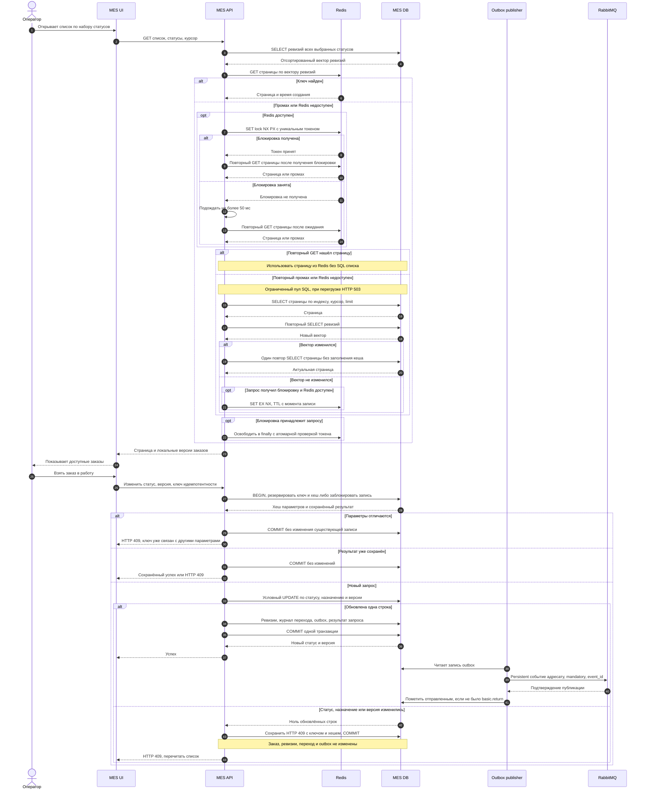
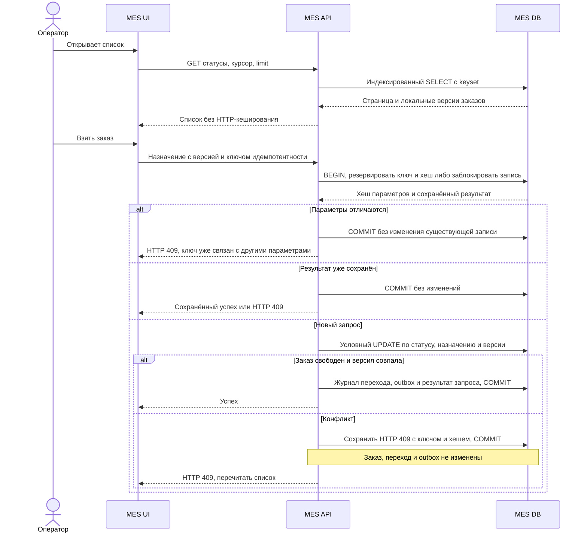

# Архитектурное решение по кешированию

## Мотивация

Операторы ждут первую страницу списка MES, а им нужны самые новые доступные заказы. Фильтр и пагинация уже есть, но ускорения нет. Значит, перед внедрением кеша надо снять план SQL, проверить индексы по фильтру и сортировке, блокировки, подсчёт общего числа строк, частоту обновления статусов и конкуренцию с расчётом цены. Кеш не исправит неоптимальный запрос на промахе и не ускорит производство. Долгий расчёт цены отделяется от интерактивного API и измеряется самостоятельно.

Кешировать предлагаю только серверное представление списка заказов MES: страницы по фиксированному набору статусов, сортировке от новых к старым и курсору, а также агрегированные счётчики статусов, если они доказанно дороги. Карточка отдельного заказа и операция взятия в работу читают и изменяют MES DB напрямую. Клиентский кеш браузера хуже подходит для общего списка: несколько операторов видят разные устаревшие копии и соревнуются за один заказ. Секретов, 3D-файлов и цены в кеше списка нет; сохраняются только поля, которые уже разрешены роли оператора.

Начальный состав страницы: `order_id`, время создания, статус, локальная версия строки и признак назначения. Если интерфейсу нужны дополнительные поля, их включают только после проверки прав и всех путей обновления. Время создания задаётся сервером и не меняется; пара `created_at, id` задаёт однозначный порядок для keyset-пагинации. Новые заказы появляются при обновлении первой страницы. Чтение следующей страницы по старому курсору не обещает показать новые записи, находящиеся выше него.

Срочная очередь из Task1 выводится рядом отдельным блоком и читается напрямую из MES DB с теми же правами доступа. Её состав зависит от текущего времени: заказ может стать срочным без изменения статуса и ревизии. Поэтому обычные версионные ключи страниц для неё не используются. Блок обновляется вместе с первой страницей; запрос проверяется отдельным планом SQL. Назначение начальником смены использует общий условный UPDATE и контракт идемпотентности. На последовательностях ниже показан кешируемый список, а срочный блок следует варианту прямого чтения БД.

Цель после оптимизации запроса и кеша: p95 первой страницы до 2 секунд при согласованной нагрузке, p95 появления нового доступного заказа на открытом экране до 2 секунд после коммита статуса, отсутствие двойного назначения операторам. Открытый экран обновляет первую страницу раз в секунду и при возвращении вкладки в фокус. Порог свежести согласуется с операторами на проверке прототипа. Считаем p95, частоту промахов и возраст данных, иначе кеш может выглядеть быстрым, скрывая пропущенные заказы.

## Предлагаемое решение

Сначала добавить в MES DB составной индекс под фактический `WHERE status ... ORDER BY created_at DESC, id DESC` и перейти на keyset-пагинацию по паре `created_at, id`. Не выполнять тяжёлый точный `COUNT(*)` при открытии первой страницы; число заказов по статусам получать отдельным запросом или агрегатом. После замера установить Redis в приватной сети и серверный Cache-Aside в MES API. Несколько экземпляров API используют один кеш. Размер страницы ограничен, произвольные фильтры не кешируются. Данные сериализуются без персональных полей.

Индекс выбирается по реальному запросу. Для одного статуса проверяется `(status, created_at DESC, id DESC)`. Для общего списка нескольких статусов такой индекс не гарантирует отсутствие дополнительной сортировки: сравнивается с частичным индексом по времени и ID для разрешённых активных статусов. `EXPLAIN (ANALYZE, BUFFERS)` снимается на release с объёмом, соответствующим prod; проверяются число просмотренных строк, сортировка и чтение диска. По результатам этой проверки выбирается индекс. В рамках задания план запроса не измерялся: исходного кода и рабочей БД нет.

Авторитетная таблица `dashboard_revision(status PRIMARY KEY, revision BIGINT NOT NULL)` находится в MES DB. Строки создаются миграцией для всех разрешённых статусов. Ключ страницы содержит `env`, версию схемы, область доступа, отсортированный список статусов и вектор их ревизий, размер страницы, курсор и порядок сортировки. Например, фильтр `MANUFACTURING_APPROVED + MANUFACTURING_STARTED` требует обе ревизии; изменение любой из них даёт другой ключ. Ключ счётчика отдельного статуса содержит его ревизию, ключ всей панели счётчиков содержит вектор всех показанных статусов. Любое изменение полей, видимых в списке, включая назначение без смены статуса, увеличивает ревизию соответствующего статуса. Вставка и удаление учитываются так же. Если поле списка берётся из связанной таблицы, его изменение тоже обязано увеличить соответствующие ревизии; иначе такое поле исключается из кеша.

Например, ключ имеет вид `mes:prod:list:v1:<scope_hash>:<filter_hash>:<revision_hash>:<limit>:<cursor_hash>`. Хеши строятся из нормализованных значений, пользовательские строки не подставляются как команды. Идентификатор оператора входит в область доступа только для персонального списка; для общей очереди используется общая разрешённая область. Проверка прав выполняется до обращения к кешу. Ответы списка имеют `Cache-Control: no-store`, чтобы браузер или промежуточный HTTP-кеш не обходили проверку серверных ревизий.

При чтении API одним запросом получает ревизии выбранных статусов из пишущего экземпляра MES DB. Для кеш-попадания после этого читает Redis. При промахе сначала проходит координацию заполнения и повторное чтение Redis, описанные ниже. Только если страница всё ещё отсутствует или Redis недоступен, делает SQL-запрос страницы и повторно читает ревизии из того же пишущего экземпляра. Эти чтения выполняются в режиме Read Committed с новым снимком для каждого SQL-запроса; read replica с неизвестным lag не используется. Если вектор изменился, результат не кладётся в кеш: API один раз перечитывает страницу и возвращает её без заполнения кеша. Если вектор не изменился и запрос получил блокировку заполнения, API выполняет `SET key value EX ttl NX`; ключ с прежней ревизией после будущего коммита уже не будет найден новыми запросами. Проверка и запись в Redis не обязаны быть атомарными с PostgreSQL: монотонная ревизия входит в неизменяемое имя ключа. TTL отсчитывается от выполнения `SET`, но медленный SQL не положит устаревший снимок без повторной проверки ревизии. Если запись произошла сразу после проверки, следующий запрос прочитает новую ревизию и пойдёт по новому ключу. Один запрос, пересекшийся по времени с коммитом, может увидеть предыдущую страницу; это учитывается в SLI свежести.

Первая страница хранится максимум 1 секунду; более старые страницы 30 секунд, если измеренный профиль обновления позволяет. Пустые результаты живут до 1 секунды. При одновременных промахах заполнение координируется короткой Redis-блокировкой `SET NX PX` с уникальным токеном и отдельным ключом для той же версии страницы. После первого промаха возможны две ветки:

1. Запрос получил блокировку. Он повторяет `GET` страницы: предыдущий владелец мог заполнить кеш между первым чтением и получением блокировки. При попадании возвращается готовая страница, SQL списка не выполняется. При повторном промахе запрос читает БД и проверяет ревизии перед заполнением кеша.
2. Блокировка занята. Запрос ждёт не более 50 мс и повторяет `GET` по тому же ключу страницы. При попадании использует результат заполнения. Только при сохранившемся промахе читает БД через ограниченный пул, без заполнения кеша этим запросом. Если пул заполнен, возвращает HTTP 503 с `Retry-After`.

Если Redis недоступен на любом шаге, запрос переходит к тому же ограниченному чтению БД. Полученная блокировка освобождается в `finally`, в том числе после повторного попадания и ошибки; удаление атомарно проверяет токен владельца. Истечение или вытеснение блокировки допускает второе заполнение, но не нарушает корректность версионных ключей. При SQL дольше 50 мс часть ожидающих запросов тоже пойдёт в БД, поэтому схема уменьшает число полных чтений, а предел нагрузки обеспечивает пул. Если строки ревизии нет, кеш обходится и отправляется диагностический алерт: значение ноль подставлять нельзя. Перезапуск или вытеснение Redis удаляет только страницы; ревизии остаются в MES DB.

При любом успешном изменении статуса обработчик в одной транзакции MES DB изменяет заказ, увеличивает его локальную версию, ревизии прежнего и нового статуса, сохраняет журнал перехода с `event_id` и создаёт запись outbox. Для HTTP-запроса в этой же транзакции сохраняется результат по ключу идемпотентности, для сообщения обновляется inbox. При изменении видимых полей без смены статуса увеличивается только одна ревизия. Строки ревизий блокируются в одинаковом порядке по имени статуса, чтобы встречные переходы не создавали взаимную блокировку. Повторная доставка с уже обработанным `(consumer, event_id)` не изменяет заказ и ревизии. После коммита новые запросы используют новые ключи, а старые страницы истекают по TTL. Redis не участвует в транзакции записи и не может сделать её неуспешной. Все пути записи, включая сообщения CRM, должны вызывать один модуль изменения MES DB; прямые SQL-обновления в обход ревизии запрещены контрактом. Рост ожидания блокировок измеряется, поскольку счётчик на статус может ограничить поток записи при большой нагрузке.

Write-Through потребовал бы синхронно поддерживать все варианты фильтров и страниц при каждом переходе, а это сложнее атомарно согласовать с БД. Refresh-Ahead тратит ресурсы на страницы, которые никто не смотрит, и может подготовить устаревший снимок как раз перед назначением заказа. Cache-Aside сохраняет БД источником истины и проще для текущей команды. Только TTL без версионирования может скрывать новый заказ весь срок кеша; удаление по отдельным ключам ненадёжно при разных фильтрах и курсорах. Ревизии в MES DB обеспечивают программную инвалидацию всех затронутых вариантов, короткий TTL ограничивает накопление старых ключей.

Операция взять заказ выполняется условным обновлением в MES DB при статусе `MANUFACTURING_APPROVED`, пустом `operator_id` и совпадении ожидаемой локальной версии строки. Победивший получает подтверждение, остальные HTTP 409 и обновляют список. Нулевая строка обновления не меняет ревизии и не создаёт событие outbox. Эта версия отличается от `dashboard_revision`: первая защищает конкретный заказ, вторая инвалидирует страницы. Повтор запроса назначения с прежним ключом идемпотентности возвращает исходный результат.

Перед условным обновлением транзакция резервирует уникальный ключ запроса в области текущего оператора и операции. Параллельный повтор ждёт результата первой транзакции, затем возвращает его; он не выполняет назначение заново. Вместе с ключом хранится хеш параметров. Другие параметры с тем же ключом дают конфликт. Предварительная проверка результата ускоряет обычный повтор, но сама по себе не заменяет уникальность в БД.

Бизнес-конфликт назначения тоже является завершённым результатом: если условный UPDATE изменил ноль строк, в записи идемпотентности сохраняются ключ, хеш параметров и ответ HTTP 409, затем выполняется COMMIT. Заказ, ревизии, журнал переходов и outbox не меняются. Повтор с теми же параметрами возвращает сохранённый 409; новые параметры с прежним ключом отклоняются, исходная запись не перезаписывается. После обновления списка новая попытка назначения получает новый ключ. ROLLBACK применяется при инфраструктурной ошибке до фиксации результата; такой запрос не считается завершённым, клиент повторяет исходные параметры.

Redis размещается в приватной сети, использует TLS и ACL только для MES API. Задаются `maxmemory` и политика вытеснения `allkeys-lru`; persistence не требуется, поскольку кеш восстанавливается из БД. Блокировка заполнения уменьшает одновременные SQL-запросы, но не защищает бизнес-операцию: её вытеснение или истечение допускает повторное чтение. Корректность обеспечивает ревизия БД. Освобождение Redis-блокировки выполняется атомарной проверкой токена и удалением. После сбоя Redis включается короткий circuit breaker, чтобы не ждать сетевой таймаут на каждом чтении. Ограниченный пул SQL-запросов защищает БД, а превышение ёмкости даёт HTTP 503 с `Retry-After`. UI выполняет обновления списка последовательно и прекращает polling в скрытой вкладке. Частота в одну секунду проверяется на нагрузочном тесте: опрос тоже создаёт нагрузку.

### Чтение и изменение статуса

Та же транзакция обновления ревизий нужна обработчикам сообщений, хотя на диаграмме показан путь оператора. Если ревизии изменились между двумя чтениями при промахе, API не делает `SET` и повторяет запрос. Если Redis недоступен, работает прямое чтение MES DB. Секундный опрос задаёт только частоту обновления: полное время от коммита до видимого заказа включает SQL, сеть и отрисовку. Начальный бюджет этого пути: до 1 секунды ожидания опроса, около 0.8 секунды на API и 0.2 секунды на отрисовку. Цель p95 до 2 секунд подтверждается измерением всего пути, а не сложением отдельных p95. При сетевых сбоях такая свежесть не гарантируется. Для более строгой видимости потребуется прямое чтение БД или отдельная транзакционная проекция.

### Сравнение вариантов

| Вариант | Плюсы | Минусы и решение |
|---|---|---|
| Индекс, keyset и оптимизация SQL без кеша | Свежая первая страница в рамках SQL-снимка, меньше компонентов | При высокой конкуренции повторные чтения нагружают БД. Это обязательный первый этап и запасной режим. |
| SQL плюс Redis Cache-Aside | Снижает повторные чтения, сохраняет единый кеш для нескольких API | Есть краткое окно устаревания и расходы на Redis. Включается только после подтверждённого нагрузочным тестом выигрыша. |
| Read replica без кеша | Снимает чтения с пишущего экземпляра | Задержка репликации также скрывает новые заказы; дороже и не убирает тяжёлый SQL. Рассматривать после замера насыщения БД. |

Для целевой архитектуры выбираю оптимизированный SQL с серверным Redis Cache-Aside. Общий кеш позволит нескольким экземплярам API повторно использовать страницы, которые запрашивают операторы, а изменение заказа останется в транзакции БД. Внедрение начинается с исправления SQL. Redis включается следующим шагом, если нагрузочная проверка подтвердит снижение задержек и нагрузки на БД без потери нужной свежести. Если выигрыша нет, остаётся вариант с прямым SQL. Критерии проверки приведены ниже.

Для варианта без Redis чтение и запись выглядят так.

Инвалидация сравнивается отдельно от выбора хранилища:

| Стратегия | Свежесть и стоимость | Решение |
|---|---|---|
| Только TTL | Простая, но новый заказ скрыт до истечения срока | Не подходит как единственная защита первой страницы |
| Удаление ключей после записи | Нужно найти все фильтры и курсоры; медленный читатель может снова записать старую страницу после удаления | Не выбирается |
| Событие инвалидации через RabbitMQ | Не нагружает запись Redis-вызовом, но задержка или потеря обработки оставляет старую страницу | Полезно для других задач, недостаточно для свежести этого списка |
| Ревизии в транзакции MES DB плюс TTL | Следующее чтение получает новый ключ; остаются лёгкое чтение БД и конкуренция за строку ревизии | Выбрано для серверного кеша |

Решение о включении Redis принимается после исправления SQL на одинаковой нагрузке: p95 чтения должен уменьшиться хотя бы на 30%, p95 первой страницы остаться до 2 секунд, а p95 появления нового заказа на открытом экране до 2 секунд. Число полных запросов списка и CPU БД должны снизиться без роста задержки записи статуса. Это первоначальные критерии, которые проверяются вместе с операторами. Общая ревизия статуса меняет ключи всех страниц соответствующего фильтра и связанных счётчиков. Даже вставка нового заказа выше курсора делает недоступной старую кешированную страницу, содержимое которой осталось прежним. TTL 30 секунд не защищает её от такой инвалидации. Поэтому малое число изменений внутри старой страницы само по себе не обосновывает кеширование.

Hit ratio, p95 и число полных SQL-запросов сравниваются отдельно для первой страницы, последующих страниц и счётчиков каждого разрешённого фильтра. Для метрик используется ограниченный перечень `filter_kind` и `page_kind`, без курсоров и ключей Redis. Если первая страница не выигрывает, для неё оставляем SQL; другие страницы и счётчики сохраняем в Redis только при собственном подтверждённом выигрыше. Если общая ревизия обнуляет пользу для всех страниц фильтра, весь этот фильтр обслуживается прямым SQL. Счётчики также отключаются независимо, если их кеш не оправдал себя.

Замер сравнивает два варианта на одинаковом числе активных операторов, скорости поступления заказов и смеси статусов. Нагрузочная проба содержит обычный поток, двукратный рост и одновременное завершение нескольких расчётов цены. Отдельно измеряются прогретый кеш, холодный старт и отключённый Redis. Включение выполняется флагом после проверки в release. При откате сначала отключают чтение кеша на всех API, затем при необходимости прекращают обновлять ревизии. Перед повторным включением меняют пространство ключей, восстанавливают обновление ревизий во всех путях записи и только затем открывают чтение кеша. Старые ключи не используются повторно после изменения схемы или восстановления БД.

Проверяются конкурентное назначение одного заказа, изменение любого статуса многозначного фильтра, вставка нового заказа, изменение видимого поля, rollback при техническом сбое, повтор события, запись во время медленного cache miss, недоступный Redis и его перезапуск. Отдельно проверяются повтор сохранённого 409 с прежними параметрами, повтор с изменёнными параметрами и два одновременных запроса с одним ключом. Должны сохраняться исходный хеш и результат, без изменений заказа и ревизий. Двойное назначение должно быть невозможно, неуспешная транзакция не меняет ревизии, а старый снимок не попадает под новый ключ. При отключении кеша запись заказа продолжает работать без изменения бизнес-процесса.

Защита от одновременных промахов проверяется двумя отдельными сценариями: первый запрос заполняет кеш за 20 мс, и ожидающие после паузы получают страницу без SQL списка; другой запрос заполняет кеш между первым `GET` и получением блокировки, и новый владелец тоже обходится без SQL списка. При заполнении дольше 50 мс проверяется ограничение конкуренции и ответ 503 сверх ёмкости пула. Отдельная вставка нового заказа должна сменить ключи и первой, и старой страницы того же фильтра; нагрузочный замер учитывает эти промахи при решении оставить кеш или отключить его для фильтра.
